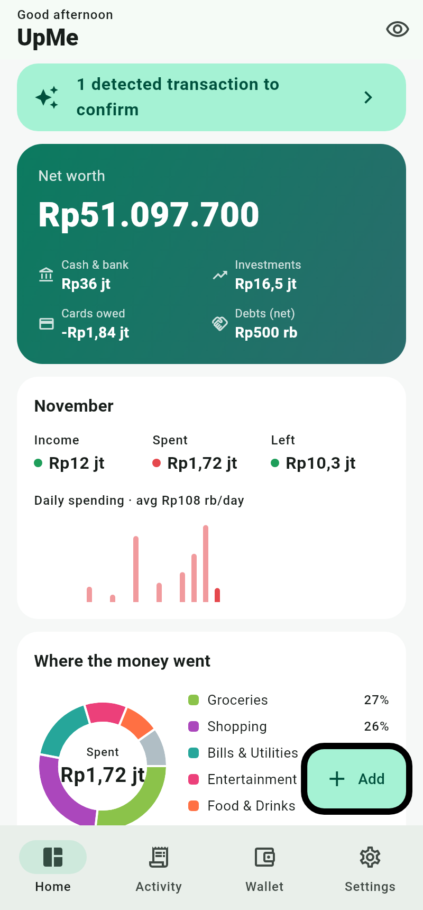
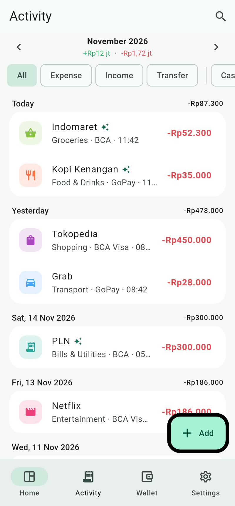
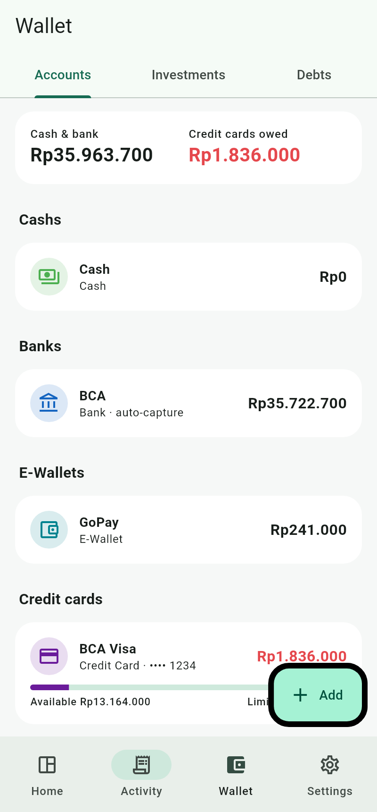
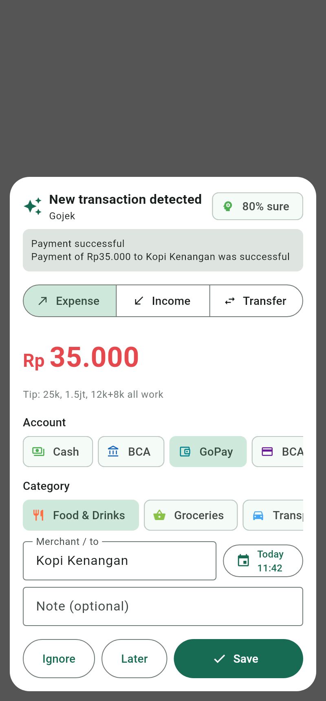

# UpMe

Personal finance for the laziest person in the world. Your bank tells your phone you paid for something; UpMe reads that notification, works out what it means, and pops up a pre-filled card. Tap **Save** and you're done.

Tracks expenses, income, bank and e-wallet balances, credit cards, investments and debts (money you owe or are owed), with a dashboard. Everything stays on the phone.

| Dashboard | Activity | Wallet | Auto-capture popup |
|---|---|---|---|
|  |  |  |  |

## Why Flutter

| | Flutter | React Native | KMP / Compose MP |
|---|---|---|---|
| One UI codebase for Android + iOS | ✅ | ✅ | ✅ (iOS Compose is newer) |
| Charts / dashboard | `fl_chart`, mature | OK | Few options |
| Native Android hooks (notification listener, overlay) | Easy: small Kotlin + MethodChannel | Easy: native module | Easiest |
| Show the *same* UI in a floating popup | ✅ separate Dart entrypoint in a transparent Activity | Awkward (second JS runtime) | ✅ |

The key requirement is the auto-capture popup, and it has to be Android-native whatever framework you pick. Flutter lets that popup run the same Dart UI and the same SQLite database as the main app, through a second entrypoint (`captureMain`). The rest of the app (forms, dashboard, charts) is a strength of Flutter.

## How auto-capture works (Android)

```
Bank app notification
   │
   ▼
TransactionNotificationListener (Kotlin, NotificationListenerService)
   │  cheap pre-filter: has an amount? not an OTP? not a promo? not a muted app? not a duplicate?
   ▼
CaptureStore (queue in SharedPreferences)
   │
   ├─ overlay permission granted ─► CaptureActivity (transparent) runs Dart `captureMain`
   │                                   └─ CaptureReview: brain fills the form, you confirm or edit
   └─ otherwise ─► "Log this?" notification ─► same popup on tap
                    (anything you skip waits in the in-app Inbox)
```

This uses **Notification access** (`NotificationListenerService`) rather than Accessibility. It's the API Android provides for reading notifications. It's more reliable, uses less battery, and Accessibility used this way gets apps rejected on Play Store.

Permissions (set up from *Settings → Auto-capture*):
1. **Notification access**: read transaction notifications.
2. **Display over other apps**: show the popup over whatever app you're in.
3. **Notifications** (optional): the quiet "tap to log" fallback.

By default UpMe listens to **every app** and reacts only to notifications that look like money. Chat and social apps are muted, and you can mute any other app from the same screen. SMS from banks works too, because your SMS app posts a notification for it.

### The "brain" (`lib/brain/transaction_brain.dart`)

Rule-based, fully on-device, and it learns from you:

1. **Noise filter**: drops OTPs, promos ("diskon hingga Rp50.000"), and failed or declined transactions.
2. **Amount**: reads `Rp 1.250.000,00`, `$1,250.50`, `IDR 50.000`, and skips "saldo/balance/limit" figures.
3. **Expense, income or transfer**: weighted keywords in Indonesian and English (`menerima`, `dana masuk`, `credited` vs `pembayaran`, `paid`, `debit`…). Credit-card context counts toward expense. "Top up GoPay from BCA" and "credit card payment" become transfers between your own accounts.
4. **Account**: scored on the linked app package, last 4 digits (`****1234`, `ending 4821`), keywords, and account name.
5. **Merchant**: extracted from "at / to / ke / di / dari / from X".
6. **Category**: built-in merchant hints (Indomaret → Groceries, Grab → Transport, PLN → Bills…).
7. **Learning**: every confirmation saves *merchant → category/type* and *app → account*. Next time those rules override the guesses.

The popup shows a confidence score. Tap it to see why the brain decided what it did. *Settings → Brain playground* lets you paste any notification text and test it.

## iOS

iOS doesn't let any app read other apps' notifications. Instead, UpMe accepts `upme://capture?app=Bank&text=...` deep links, so a **Shortcuts automation** can forward data automatically:
- *Message* trigger (bank SMS) → URL with the message text → Open URL
- *Transaction* trigger (Apple Pay / Wallet) → `...&text=Paid {Amount} at {Merchant}`

The same confirm sheet opens, pre-filled by the brain. Step-by-step instructions are in the app under *Settings → Auto-capture* on iOS.

## Features

- **Dashboard**: net worth (cash + investments + money owed to you − card debt − money you owe), this month's income, spending and what's left, daily spending bars, category donut, accounts, 6-month trend, recent activity.
- **Transactions**: add, edit or delete; swipe to delete; month navigation; filter by type or account; search everything. The amount field takes `25k`, `1.5jt`, `10rb` and `12k+8k`.
- **Accounts**: cash, bank, e-wallet, credit card (limit, outstanding, available), other. "Set actual balance" reconciles by recording an adjustment that doesn't count as spending.
- **Credit cards**: purchases are expenses on the card; paying the card is a transfer from your bank.
- **Investments**: invested vs current value, gain %, quick "update value".
- **Debts**: I owe / owed to me, due dates, partial payments, optionally reflected in an account. Excluded from spending charts.
- **Inbox** for postponed captures, **hide amounts** toggle, light/dark theme, 11 currencies, editable categories.

## Project layout

```
lib/
  main.dart                    main() + captureMain() (popup entrypoint)
  brain/                       transaction classifier + built-in hints
  core/                        money formatting/parsing, settings
  data/                        models, SQLite schema, repository (ChangeNotifier)
  platform/capture_bridge.dart MethodChannel `upme/capture`
  ui/                          dashboard, activity, wallet, settings, capture popup
android/app/src/main/kotlin/app/upme/upme/capture/
  TransactionNotificationListener.kt  CaptureFilter.kt  CaptureStore.kt
  CaptureActivity.kt  CaptureChannel.kt
test/                          brain, repository (SQLite via ffi), widget smoke test
```

## Run

```bash
flutter pub get
flutter test
flutter run            # on an Android device for auto-capture
```

Then open *Settings → Auto-capture* and grant the two permissions. Add your accounts in *Wallet*. Linking an account to its bank app, or entering its last 4 digits, makes account matching much more reliable.

> **Battery-saver note:** Xiaomi, Oppo, Vivo and some Samsung phones kill background services. If capture stops, set UpMe's battery usage to *Unrestricted* and allow autostart.
